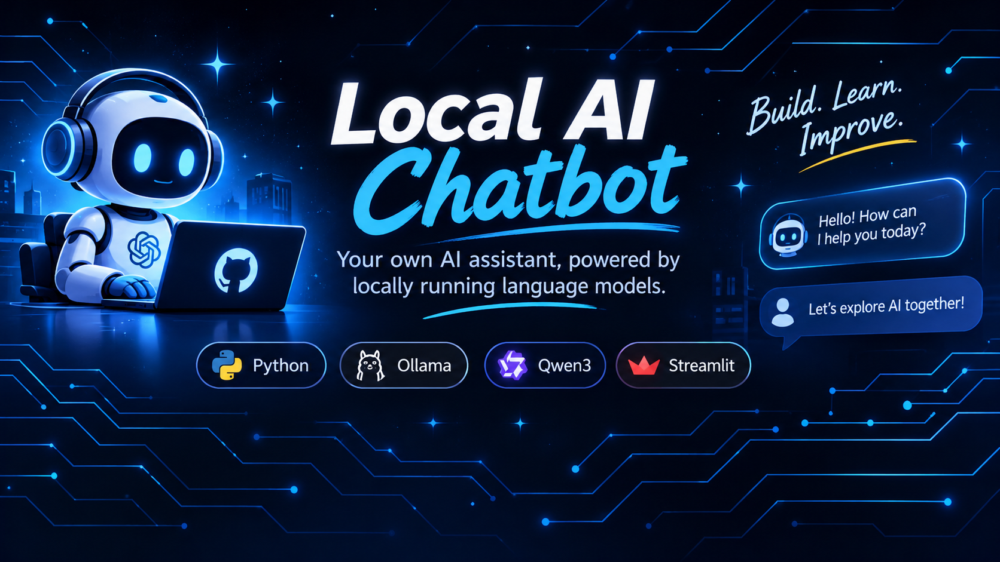

<p align="center">
  
</p>
# 🤖 Local AI Chatbot

### Your own AI assistant, powered by locally running language models.

A hands-on Generative AI project built using **Python, Ollama and Qwen3**. The goal is to develop a conversational AI chatbot that runs locally on your computer, with a clean interface and useful conversational features.

<p align="center">
  
  
  
  
</p>

---

## 📌 About the Project

This project explores how Large Language Models (LLMs) can be integrated into Python applications.

Instead of relying on a paid cloud API, this chatbot uses Ollama to run Qwen3 locally and communicate with it through a local API.

The project is being developed step by step, starting with a basic Python-to-LLM connection and gradually expanding into a complete chatbot application.

## ⚙️ Technology Stack

| Technology | Purpose |
|---|---|
| Python | Main programming language |
| Ollama | Runs the language model locally |
| Qwen3:4b | Language model |
| Streamlit | Planned chatbot interface |
| Requests | Communicates with Ollama's API |
| Git & GitHub | Version control and project hosting |

## 🏗️ Current Architecture

```text
User Prompt
    |
    v
Python Application
    |
    v
Ollama Local API
    |
    v
Qwen3:4b Model
    |
    v
AI Response
    |
    v
Python Application
```

## ✅ Current Progress

- [x] Python project setup
- [x] Virtual environment configuration
- [x] Ollama installation
- [x] Qwen3:4b model setup
- [x] Python integration with Ollama API
- [ ] Conversation memory
- [ ] Streamlit chat interface
- [ ] Streaming responses
- [ ] Chat history
- [ ] Final UI improvements

## 🚀 Getting Started

### Prerequisites

- Python
- Ollama
- Git

### 1. Clone the repository

```bash
git clone https://github.com/thakurtanish38-creator/Local-AI-Chatbot.git
```

### 2. Open the project

```bash
cd Local-AI-Chatbot
```

### 3. Create a virtual environment

```bash
python -m venv .venv
```

### 4. Activate the environment (Windows PowerShell)

```powershell
.venv\Scripts\Activate.ps1
```

### 5. Install dependencies

```bash
pip install -r requirements.txt
```

### 6. Download the language model

```bash
ollama pull qwen3:4b
```

### 7. Run Ollama

Make sure Ollama is running on your computer.

### 8. Test the Python integration

```bash
python test_llm.py
```

## 📁 Project Structure

```text
Local-AI-Chatbot/
│
├── app.py
├── test_llm.py
├── requirements.txt
├── .gitignore
└── README.md
```

## 🎯 Project Goals

The long-term goal is to build a functional local AI chatbot with:

- Conversational memory
- Real-time response streaming
- Interactive chat interface
- Chat history management
- Customisable assistant behaviour
- Local LLM integration

## 📚 Learning Outcomes

Through this project, I am exploring:

- Large Language Models
- Prompt engineering
- API integration
- Python application development
- Conversational AI
- Frontend and backend integration
- Git and GitHub workflows

---

**Status:** Work in Progress 🚧

Built as a hands-on learning project in Generative AI.
